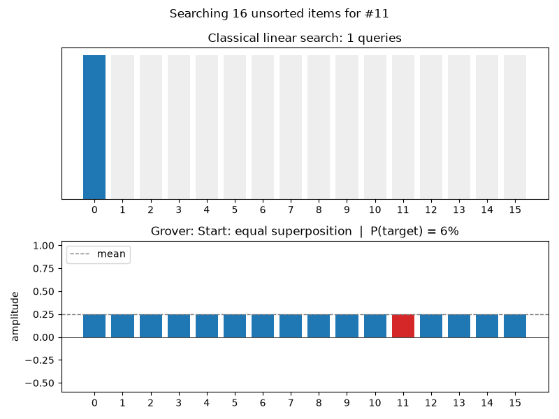
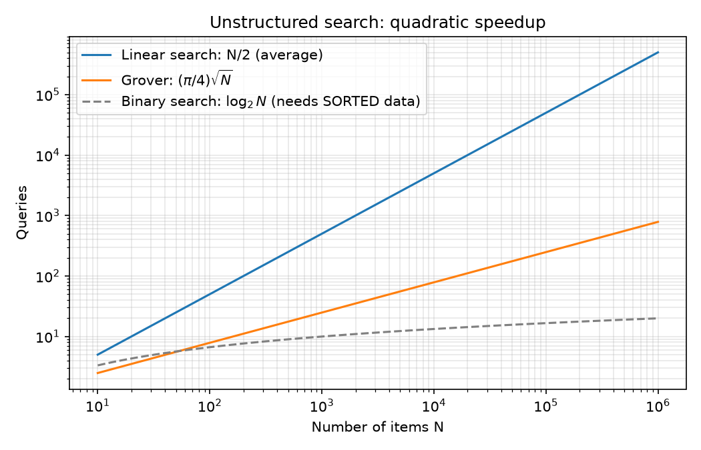
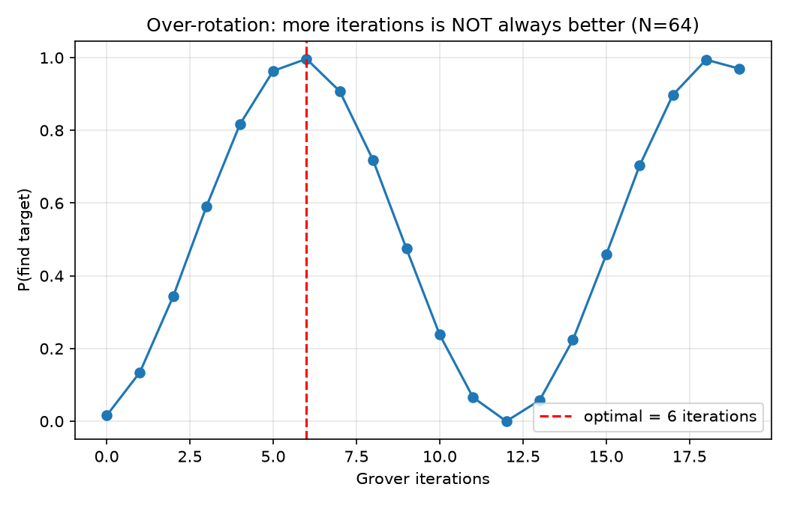

# Grover's Search vs Linear Search

A small project comparing classical linear search with Grover's quantum search algorithm, with visualizations of *why* Grover works.



## The problem
Find one marked item among N **unsorted** items. Classically there's no shortcut: you check items one by one, about N/2 checks on average. Grover's algorithm needs only about (π/4)·√N oracle queries, a quadratic speedup.

## How Grover works
1. **Superposition:** Hadamard gates put n qubits into an equal superposition of all N = 2ⁿ items. Every item has the same amplitude, 1/√N.
2. **Oracle:** flips the *sign* of the target's amplitude. Measuring now would still look uniform, because probability is amplitude squared.
3. **Diffuser:** reflects every amplitude about the mean. Since the target is now below the mean, it gets pushed far above it, and the others shrink slightly.
4. Repeat steps 2–3 about (π/4)√N times, then measure. The target comes out with high probability.

## Results (simulator)
3 qubits (8 items), target `101`, 2 iterations:

| | Queries | Success |
|---|---|---|
| Linear search | 6 for this target (4 on average) | 100% |
| Grover | 2 | 95.1% (theory: 94.5%) |



### Over-rotation
Grover is a rotation in a 2D plane. Run too many iterations and you rotate *past* the target, so the success probability falls again. Choosing the iteration count matters.



### Where Grover does **not** help
If the data is **sorted**, classical binary search needs only log₂N steps (about 20 for a million items), which beats Grover's ~785. Grover's advantage only applies to unstructured search.

## Extra: entanglement basics
`bell_teleport.py` builds a Bell state (measurements give only `00` or `11`) and teleports a qubit state, with a fidelity of 1.0.

## Run it
```bash
pip install -r requirements.txt
python grover.py              # Grover on simulator vs linear search
python visualize.py           # regenerates images/
python bell_teleport.py       # Bell state + teleportation
python grover.py --hardware   # optional: real IBM device (pip install qiskit-ibm-runtime)
```
